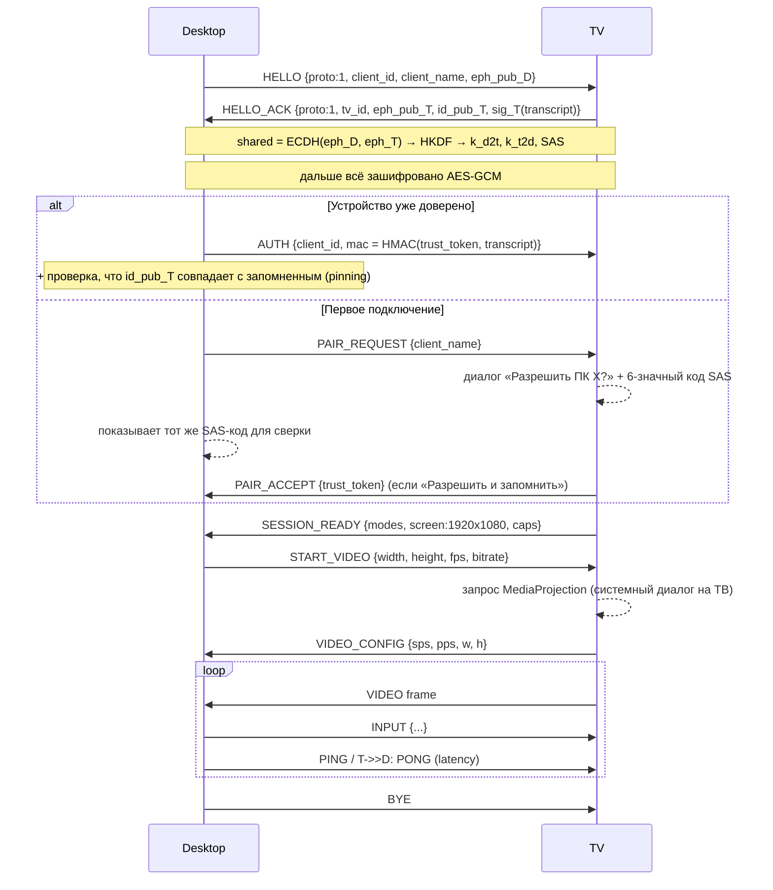

# TVconnect — архитектура (черновик на согласование)

LAN Remote Desktop для Android TV / Google TV. Работает только в локальной сети: без облака, relay, STUN/TURN, интернет-аутентификации.

---

## 1. Архитектура проекта

```
┌──────────────────────── Desktop Client (Windows / Linux) ────────────────────────┐
│  UI (Qt Widgets)                                                                 │
│   ├─ DeviceListWindow  ── список ТВ, IP, статус, Connect / Disconnect / Refresh  │
│   └─ ViewerWindow      ── видео, fullscreen, FPS, разрешение, latency, качество  │
│                                                                                  │
│  Device Manager ── объединяет результаты discovery + ручные IP + доверенные ТВ   │
│  LAN Discovery  ── mDNS (_tvconnect._tcp) + UDP broadcast (fallback)            │
│  Connection Mgr ── TCP → SecureChannel (ECDH + AES-GCM) → мультиплекс каналов    │
│  Video Decoder  ── H.264 → FFmpeg (PyAV), опционально HW (d3d11va / vaapi)       │
│  Input Ctrl     ── Qt-события → протокольные InputEvent → Native или ADB backend │
│  ADB Backend    ── ограниченный API поверх adb (валидация, без произвольного sh) │
│  Settings / Trust Store (ключи в OS keyring: DPAPI / Secret Service)             │
└──────────────────────────────────────────────────────────────────────────────────┘
                       ▲  TCP :47800 (зашифровано)   ▲ UDP :47801 / mDNS :5353
                       │                              │
┌──────────────────────┴───────── TV Client (Android TV, Kotlin) ──────────────────┐
│  UI (Leanback-friendly Activity, D-pad навигация)                                │
│   ├─ MainActivity      ── имя, IP, статус, подключённый клиент, Disconnect       │
│   ├─ PairingDialog     ── запрос подтверждения + код сверки (SAS)                │
│   └─ SettingsActivity  ── автозапуск, доверенные устройства, выкл. управления     │
│                                                                                  │
│  ConnectionService (Foreground Service) ── держит TCP-сервер                     │
│  LAN Discovery    ── NsdManager (mDNS) + UDP-responder                           │
│  Authentication   ── identity key (AndroidKeyStore), trust store (хэши токенов)  │
│  Video Capture    ── MediaProjection → VirtualDisplay → Surface                  │
│  Video Encoder    ── MediaCodec H.264 (HW), surface input, low-latency           │
│  Input Handler    ── AccessibilityService: жесты, global actions, текст, курсор  │
│  BootReceiver     ── автозапуск слушателя после загрузки (если разрешено)        │
└──────────────────────────────────────────────────────────────────────────────────┘
```

Два режима работы (выбираются на десктопе для каждого ТВ):

| | **Native Agent Mode** | **ADB Mode** |
|---|---|---|
| Видео | MediaProjection + MediaCodec в TV-приложении | `screenrecord --output-format=h264` через adb (Phase 1), позже — собственный shell-агент |
| Ввод | AccessibilityService (жесты, global actions, текст) | `input keyevent / tap / swipe / text` через adb — полный набор клавиш |
| Требует | установленное приложение, подтверждение захвата на ТВ | включённую «Отладку по сети» и подтверждение RSA-ключа один раз |
| Без человека у ТВ | нет (Android требует подтверждения захвата каждую сессию) | да |

Режимы комбинируются: например, видео через Native, ввод через ADB — это самый практичный вариант для полного управления.

---

## 2. Стек и обоснование

### TV Client
- **Kotlin + Android SDK**, minSdk 26 (Android 8.0 — практически все живые Android TV), targetSdk 35.
- **Coroutines** для сети и пайплайна, **MediaProjection + MediaCodec** (H.264 surface input).
- UI: обычные View + фокусируемые элементы (без Compose for TV, чтобы не тянуть тяжёлые зависимости и не ломаться на старых ТВ).
- Крипто: стандартные JCA (`EC P-256`, `ECDH`, `AES/GCM`, `HmacSHA256`) + AndroidKeyStore — без сторонних библиотек.

### Desktop Client — **Python 3.11+ / PySide6 (Qt 6)**
Сравнение:

| Вариант | Плюсы | Минусы |
|---|---|---|
| Qt / C++ | максимальная производительность | самый медленный MVP: FFmpeg/сборка/CI под 2 ОС |
| **Qt / Python (PySide6)** | нативный Qt UI, одна кодовая база, PyAV даёт FFmpeg-декодер готовыми wheel'ами под Win/Linux, `zeroconf` и `cryptography` — зрелые; быстрый цикл разработки | выше потребление памяти, сборка PyInstaller ~80–120 МБ |
| Flutter | красивый UI | видео-декод H.264 на desktop — через плагины/FFI, слабый Linux-видео стек |
| Rust + Tauri | производительность, маленький бинарник | UI — это WebView (по сути браузерное приложение), что противоречит требованию |

**Выбор: PySide6.** Узкие места (декод H.264, отрисовка) выполняются в нативном коде FFmpeg/Qt, Python лишь склеивает. 1080p30 декод через PyAV — ~5–10 мс/кадр на CPU. macOS в будущем — тот же код (PySide6 и PyAV поддерживают macOS). Сборка: PyInstaller → `.exe` (Windows) и onedir/AppImage (Linux).

Зависимости: `PySide6`, `av` (PyAV), `zeroconf`, `cryptography`, `keyring`, `numpy`. ADB — системный `adb` или путь из настроек (бандлить platform-tools не обязательно).

---

## 3. Структура репозитория

```
TVconnect/
├─ README.md
├─ docs/
│  ├─ ARCHITECTURE.md          ← этот документ
│  ├─ PROTOCOL.md              ← формат сообщений, версии, handshake
│  ├─ ANDROID_LIMITATIONS.md
│  └─ BUILD.md                 ← сборка APK, установка, запуск desktop
├─ protocol/
│  └─ test-vectors/            ← общие тест-векторы для обеих реализаций (framing, KDF, MAC)
├─ tv-app/                     ← Gradle-проект Android
│  ├─ settings.gradle.kts, build.gradle.kts, gradlew
│  └─ app/src/main/
│     ├─ AndroidManifest.xml
│     ├─ res/ (layouts, strings ru/en, accessibility config)
│     └─ java/dev/tvconnect/tv/
│        ├─ ui/          MainActivity, PairingActivity, SettingsActivity, ProjectionRequestActivity
│        ├─ service/     ConnectionService (FGS), BootReceiver
│        ├─ discovery/   NsdAdvertiser, UdpDiscoveryResponder
│        ├─ net/         Server, Session, Framing, SecureChannel, Messages
│        ├─ capture/     ScreenCapture (MediaProjection + VirtualDisplay)
│        ├─ encoder/     H264Encoder (MediaCodec)
│        ├─ input/       RemoteInputService (AccessibilityService), CursorOverlay, KeyMapper
│        ├─ auth/        IdentityKey, TrustStore, Pairing
│        └─ settings/    Prefs
├─ desktop/
│  ├─ pyproject.toml, requirements.txt
│  ├─ tvconnect_desktop/
│  │  ├─ __main__.py, app.py, logging_setup.py, settings.py
│  │  ├─ protocol/   messages.py, framing.py, version.py
│  │  ├─ net/        connection.py, secure_channel.py
│  │  ├─ discovery/  mdns.py, udp.py
│  │  ├─ devices/    device_manager.py, trust_store.py
│  │  ├─ video/      decoder.py, adb_stream.py
│  │  ├─ input/      controller.py, keymap.py
│  │  ├─ adb/        adb_client.py (валидируемый API)
│  │  └─ ui/         main_window.py, viewer.py, pairing_dialog.py, settings_dialog.py
│  ├─ tests/
│  └─ packaging/ tvconnect.spec, tvconnect.desktop
└─ scripts/ build_desktop_win.ps1, build_desktop_linux.sh
```

---

## 4. Сетевое взаимодействие

### Порты
| Порт | Протокол | Назначение |
|---|---|---|
| 47800/TCP | TVconnect | единое зашифрованное соединение: control + video + input |
| 47801/UDP | broadcast | fallback-discovery (`TVC_DISCOVER` → JSON-ответ) |
| 5353/UDP | mDNS | `_tvconnect._tcp.local.`, TXT: `id`, `name`, `ver`, `model` |
| 5555/TCP | adb | только ADB Mode |

Почему один TCP вместо отдельного UDP для видео: в LAN потери почти нулевые, `TCP_NODELAY` + небольшие буферы дают задержку уровня UDP, при этом не нужен свой FEC/реассемблинг и шифровать проще. Перегрузку решаем на источнике: если очередь отправки > N кадров — кадры отбрасываются до следующего IDR, и энкодеру запрашивается ключевой кадр.

### Фрейминг (после handshake всё зашифровано)
```
┌──────────┬──────────┬─────────────────────────────┐
│ len u32  │ type u8  │ payload (len-1 bytes)       │   plaintext record
└──────────┴──────────┴─────────────────────────────┘
зашифрованная запись = len u32 | AES-256-GCM(nonce = dir‖counter64, record) | tag16
```
Типы: `0x01 CONTROL` (JSON), `0x02 VIDEO` (binary: flags u8, pts_us u64, Annex-B NAL), `0x03 INPUT` (JSON, компактный), `0x04 PING/PONG`.

### Handshake и pairing


- **SAS** (short authentication string) из общего секрета защищает от MITM при первом сопряжении: пользователь сверяет одинаковый код на ПК и ТВ.
- **trust_token** (32 случайных байта): ТВ хранит только `SHA-256(token)` (+ метаданные клиента), десктоп хранит токен в OS keyring (Windows Credential Manager/DPAPI, Linux Secret Service). Plain-text токенов на диске нет.
- **Pinning:** десктоп запоминает отпечаток `id_pub_T` (ключ ТВ лежит в AndroidKeyStore, неэкспортируемый) — подмена ТВ будет обнаружена.
- **Защита от случайных подключений:** без pairing — только HELLO; лимит 1 активной сессии; rate-limit запросов pairing; переключатель «Удалённое управление выключено» на ТВ.
- **Версионирование:** `proto` в HELLO; мажорная несовместимость → `ERROR {code: "proto_mismatch"}`; новые поля в JSON — только опциональные.

### Input-сообщения (пример)
```json
{"t":"mouse","a":"move","x":0.512,"y":0.330}         // нормализованные 0..1
{"t":"mouse","a":"down","b":"left"}  {"t":"mouse","a":"up","b":"left"}
{"t":"scroll","dx":0,"dy":-3}
{"t":"key","a":"down","code":"DPAD_UP","meta":0}     // имена Android KeyEvent
{"t":"text","s":"привет"}
```
Маппинг клавиш делается на десктопе (Qt key → Android `KEYCODE_*`), ТВ получает уже Android-коды — одна таблица, легко расширяется под macOS.

---

## 5. Ограничения Android TV (важно)

1. **MediaProjection требует подтверждения на ТВ каждую сессию.** На Android 14+ токен нельзя переиспользовать; приложение обязано запустить foreground service типа `mediaProjection` *до* получения проекции. Значит, Native Mode **не даёт** полностью безлюдного доступа — кто-то должен нажать «Начать» пультом. *Workaround:* ADB Mode (захват через shell-права adb без диалога).
2. **На части прошивок нет/сломан диалог MediaProjection** (встречается на дешёвых ТВ и некоторых Google TV). *Workaround:* ADB-видео.
3. **Защищённый контент** (Netflix, YouTube с DRM, окна с `FLAG_SECURE`) будет чёрным в любом режиме. Обойти нельзя и не будем.
4. **Обычное приложение не может инжектить KeyEvent** (`INJECT_EVENTS` — только системным). AccessibilityService умеет:
   - жесты `dispatchGesture` (тап, свайп, drag — API 26+) → клик/скролл/drag мышью;
   - `GLOBAL_ACTION_BACK/HOME/RECENTS/NOTIFICATIONS`;
   - `GLOBAL_ACTION_DPAD_UP/DOWN/LEFT/RIGHT/CENTER` — **только Android 13+ (API 33)**;
   - ввод текста через `ACTION_SET_TEXT` в сфокусированное поле;
   - громкость — через `AudioManager` (без accessibility).
   Нельзя: MENU, Tab, Escape, F-клавиши, произвольные коды, DPAD на Android < 13. Многие TV-приложения игнорируют touch и работают только через фокус/D-pad.
   *Workaround:* для этих клавиш — ADB Mode (`input keyevent` поддерживает любые `KEYCODE_*`).
5. **Курсор мыши**: на ТВ нет системного курсора для touch-инжекта — рисуем свой через overlay `TYPE_ACCESSIBILITY_OVERLAY` (не требует `SYSTEM_ALERT_WINDOW`, которого на многих ТВ нет в настройках).
6. **Включение Accessibility Service**: на некоторых Google TV пункт спрятан. *Workaround:* `adb shell settings put secure enabled_accessibility_services ...` (документируем).
7. **Автозапуск после загрузки**: `BOOT_COMPLETED` работает, но Android 15 запрещает стартовать FGS типа `mediaProjection` из boot. Слушатель запускаем как FGS типа `specialUse` (API 34+) / обычный FGS на старых — он только ждёт подключений; захват стартует уже по запросу с подтверждением. Некоторые OEM-лаунчеры убивают фоновые сервисы — отключается в настройках ТВ.
8. **ADB по сети**: Android TV 9–10 — «Отладка по сети» (порт 5555); Android 11+ — «Беспроводная отладка» с кодом сопряжения (`adb pair`). При первом подключении ТВ спрашивает подтверждение RSA-ключа ПК. Root не нужен.
9. **ADB `input` медленный** (~100–300 мс на команду из-за старта `app_process`). Phase 1: постоянная `adb shell`-сессия и очередь команд. Phase 3: собственный shell-агент (запуск нашего dex через `app_process` с правами shell, как это делают open-source инструменты) — ввод и захват с задержкой < 20 мс.
10. **`screenrecord`** ограничен 3 минутами за запуск — десктоп автоматически перезапускает поток (короткий разрыв ~0.5 с). Устраняется shell-агентом в Phase 3.
11. **mDNS на Wi-Fi**: нужен `MulticastLock`; часть роутеров (client isolation, IGMP snooping) блокирует multicast — поэтому есть UDP broadcast и ручной IP.
12. **Энкодер**: слабые SoC тянут 1080p30, но не 1080p60. Ставим `KEY_LOW_LATENCY` (API 30+), `KEY_REPEAT_PREVIOUS_FRAME_AFTER` (статичный экран), запрос IDR по требованию.

Бюджет задержки (1080p30, LAN): захват ~16 мс + кодирование 10–25 + сеть 2–5 + декод 5–15 + отрисовка ≤16 → **~60–120 мс** в Native Mode; ADB `screenrecord` — ~150–300 мс.

---

## 6. План реализации

### Phase 1 — PoC (реализую после согласования)
TV:
- Gradle-проект, MainActivity (имя, IP, статус), ConnectionService с TCP-сервером.
- Framing + SecureChannel + handshake + pairing с подтверждением на ТВ (закладываю сразу — переделывать протокол потом дороже).
- MediaProjection + MediaCodec H.264 → поток на десктоп.
- Базовый AccessibilityService: BACK, HOME, тап по координатам, текст, громкость.

Desktop:
- PySide6-приложение: окно со списком, ручной ввод IP, Connect/Disconnect.
- Подключение, pairing-диалог с SAS, хранение токена в keyring.
- PyAV-декодер + ViewerWindow (FPS, разрешение, latency по PING).
- ADB-бэкенд: `adb connect`, валидируемые команды (`keyevent` по белому списку кодов, `tap/swipe` с проверкой координат, `text` с экранированием), ADB-видео через `screenrecord` с авто-перезапуском.
- Маппинг клавиатуры/мыши → Android.
- Логирование в файл (ротация) на обеих сторонах, обработка ошибок и переподключение.
- README + BUILD.md (сборка APK, установка через `adb install`, запуск десктопа).

### Phase 2 — MVP
mDNS/UDP discovery, список доверенных, удаление доверенных, настройки качества/FPS/разрешения на лету, полное управление мышью (курсор-overlay, drag, scroll), PyInstaller-сборки Win/Linux, BootReceiver.

### Phase 3 — Improvements
Shell-агент для ADB Mode (низкая задержка ввода/видео, без лимита 3 мин), HW-декод (d3d11va/vaapi) и рендер через OpenGL, автоподключение, несколько ТВ одновременно, адаптивный битрейт.

---

## 7. Статус реализации (Phase 1 завершена)

Окружение: JDK 17, AGP 8.6.0 / Kotlin 1.9.24 / Gradle 8.9 (wrapper), Android SDK в `C:\AndroidSDK`,
Python 3.14 + PySide6 6.12 + PyAV 19.

Проверено end-to-end на Xiaomi Mi TV Stick (Android 11, API 30):

| Сценарий | Результат |
|---|---|
| Discovery mDNS + UDP | ТВ найден обоими способами |
| Pairing с SAS, «Разрешить и запомнить», повторный вход по токену | работает, повторный вход без диалога |
| MediaProjection → H.264 → AES-GCM/TCP → PyAV | 720p и 1080p @30, RTT 20–60 мс, декод 1.3–2.5 мс |
| Клавиши через ADB (auto) и D-pad через Accessibility focusSearch | работает |
| Мышь: жест Accessibility → отмена системой → повтор через ADB | работает (тап открывает нужный экран) |
| ADB Mode (screenrecord + input) без TV-приложения | работает |

Изменения по сравнению с исходным планом:
- Phase 2 частично сделана сразу: discovery, pairing, клавиатура, базовая мышь, курсор-оверлей, BootReceiver.
- В TV-приложении нет корутин и androidx: используются потоки и стандартные API, сторонних зависимостей нет. Это
  убирает риск несовместимостей на старых ТВ и уменьшает APK до ~0.9 МБ.

Осталось (Phase 2/3): проверенные PyInstaller-сборки на Linux, HW-декодирование на ПК (d3d11va/vaapi) и
OpenGL-рендер, shell-агент для ADB Mode, автоподключение, адаптивный битрейт.
